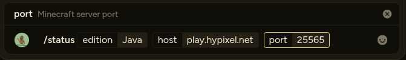

# Craftie - A Slack bot for getting minecraft info

This is a bot I made for the Hack Club Slack that fetches specific minecraft-related info using slack commands.

## Commands:

The following commands are available with this bot:

> [!IMPORTANT]
> All commands use the prefix `craftie-` on hackclub slack

`/status (java|bedrock) <server> [port]`
fetches information on minecraft servers, both bedrock and java, such as their MOTD, how many players are online, what minecraft version it uses and more.

`/player-status <name|uuid>` (`/craftie-player` on slack) fetches information on a minecraft player account using their username or UUID. It currently only shows the UUID, username, and skin images.

`/help` outputs a list of all available commands with their usage.

`/ping` replies with pong to indicate the bot is working.

# How to use the bot (as a hack club member)

## Slack:

To use the bot on slack you either have to configure the bot to use it on your own slack, or join the [hackclub](https://hackclub.com/) slack.

On the hack club slack the bot is added to [`#gold-coding`](https://hackclub.enterprise.slack.com/archives/C0BE1K8EW82) (my personal channel) and [`#bot-spam`](https://hackclub.enterprise.slack.com/archives/C0P5NE354), so it is recommended you use it there.

Excecuting the commands themselves is pretty easy, as you can just start typing `/craftie-` and all commands will be at top. If you want to know what all commands are you can do `/craftie-help`

## Discord:

To use the bot you can either add it to your own discord server or as a personal app using the [invite link](https://discord.com/oauth2/authorize?client_id=1551701776753885196). The other option is to join my [discord server](https://discord.gg/SGxwmZUfnQ), where the bot is already added and you can use it in `#bot-commands`.

Then you can just use the commands like any other discord command by typing / and then filling in the options for the command, like this:

# Screenshots:

